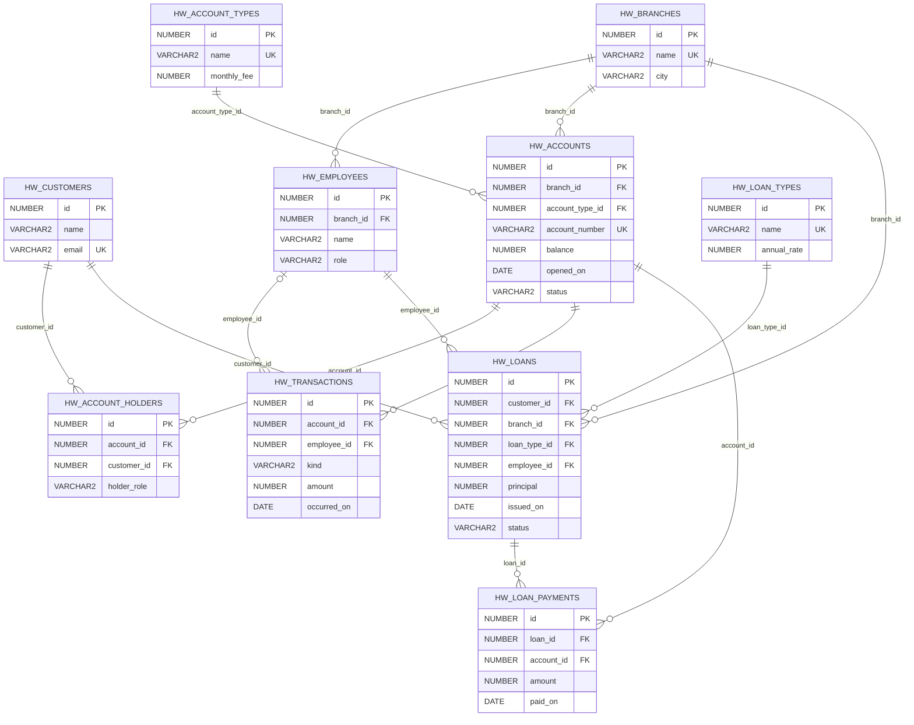

# Banking ERD

Generated from `scenario/banking.js`; do not edit this file by hand.

`||` = exactly one parent; `|o` = zero or one parent; `o{` = zero or many children.

Every table has numeric `id` as its primary key. Foreign keys are labelled FK. A customer can hold many accounts and an account can have many customers through `HW_ACCOUNT_HOLDERS`; its `(account_id, customer_id)` pair is unique. Transactions may have no employee (self-service). Every other reference requires exactly one parent. Deletion is restricted: remove or reassign children first.

Branches connect employees, accounts and loans. Account types classify accounts; loan types classify loans. Each loan belongs to a customer and an advisor. Payments reference both the repaid loan and the paying account. An account may have no transactions and a loan may have no payments yet. All amounts are synthetic RON values.
